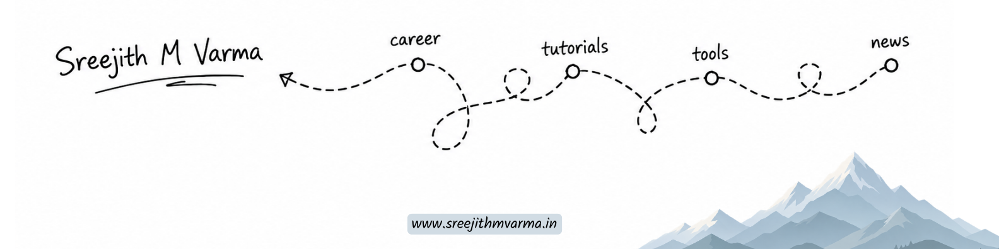

## Hey, I'm Sreejith!

CS grad from NSSCE Palakkad. During my internships at IIT Ropar, Amrita, and Tarento I got to work on some genuinely interesting problems - real-time systems, multimodal AI, vision-language models, LLMs.

I don't have a fixed stack or a favourite framework. I try whatever the project or the curiosity calls for. Lately that's been a lot of Python for AI/ML, and JavaScript/TypeScript for building things on the web. If something new drops and it looks interesting, I'm probably already poking at it.

Right now I'm learning in public - making videos, writing, and building things openly as I go. Not because I have it all figured out, but because I think that's a more honest way to grow.

## Currently

- Creating content around tech and AI - videos, writing, and learning in public. Check it out at [sreejithmvarma.in](https://sreejithmvarma.in)
- Deep into agentic AI and orchestration lately - figuring it out as it evolves
- Turning whatever is new and nascent into real applications and solutions
- Connecting the dots for the long term - but something new gets built every month

## Connect

&nbsp;

*If you read something useful here or on my channel — that's enough for me.*
